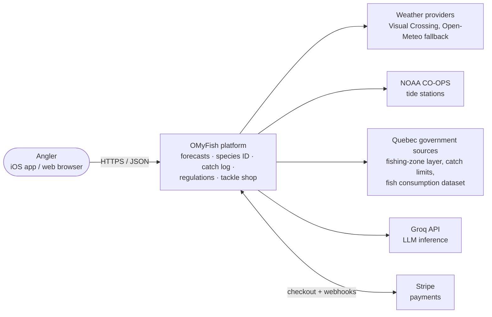
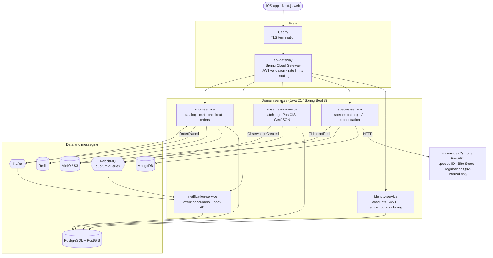
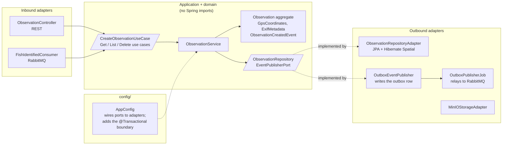
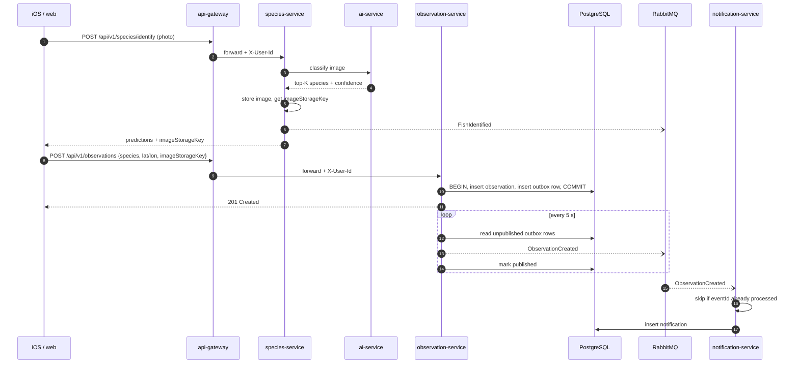

# OMyFish Architecture

This document describes the production system as built. Where something is a deliberate simplification, it's called out as one.

## 1. System context (C4 level 1)

Regulations are fetched live from the authoritative government sources rather than copied into a static dataset, so the app reflects the current rules.

## 2. Containers (C4 level 2)

| Container | Responsibility |
|---|---|
| **api-gateway** | Single public entry point. Validates the JWT, then forwards the caller's identity to downstream services as `X-User-Id` / `X-User-Email` / `X-User-Role` headers. It first strips any such headers the client sent, so identity can't be spoofed. Per-IP rate limits on the expensive routes (species ID, forecasts, payment calls). |
| **identity-service** | Registration, login, refresh tokens, API keys, subscription lifecycle (trial → active → past-due/canceled), Stripe webhooks with event de-duplication. |
| **species-service** | Species catalog (MongoDB). Orchestrates the AI service for identification, Bite Score forecasts and regulation lookups. Stores uploaded images. Publishes `FishIdentified`. |
| **observation-service** | The catch log: create/list/delete observations, PostGIS location column with a GIST index, radius search (`ST_DWithin`), public GeoJSON feed. Publishes `ObservationCreated` through a transactional outbox. |
| **notification-service** | Consumes domain events and turns them into a per-user notification inbox (`GET /api/v1/notifications`, `PUT /{id}/read`). |
| **shop-service** | Product catalog (Redis + in-process cache, read/write datasource routing), carts for both guests and signed-in users, Stripe checkout, orders and returns. Order events go to Kafka for an ordered, replayable ledger. |
| **ai-service** | The ML and forecasting domain. Never exposed publicly: it's reached only through species-service, so authentication, entitlements and rate limits are enforced in one place. |

## 3. Inside a service: hexagonal architecture (C4 level 3)

Every Java service follows the same ports-and-adapters layout. `observation-service`:

The rules that keep it honest:

- `domain/` and `application/` contain no framework imports. Use cases are plain Java and are unit-tested without Spring.
- Inbound ports (`domain/port/in`) are what the outside world may ask for. Outbound ports (`domain/port/out`) are what the core needs, and adapters implement them.
- Transactions are a wiring concern, not a domain concern. `config/` wraps the use case in a `@Transactional` decorator, so the core stays framework-free while the observation insert and its outbox row still commit atomically. See [`samples/hexagonal/`](samples/hexagonal/).

## 4. Event flow

Image upload is two-step by design. The photo is stored once at identification time, and the observation references it by key, so saving a catch never re-uploads the image.

**Delivery guarantees:**

| Concern | Mechanism |
|---|---|
| Event lost if the service crashes between the DB write and the broker publish | Transactional outbox: the event row commits in the same transaction as the aggregate ([`samples/outbox/`](samples/outbox/)) |
| Event delivered twice (relay crash after send, broker redelivery) | At-least-once delivery accepted; consumers de-duplicate by `eventId` ([`samples/messaging/`](samples/messaging/)) |
| Broker node loss | RabbitMQ quorum queues (Raft-replicated) |
| Payment webhook retried by Stripe | `ProcessedWebhookEvent` table de-duplicates by Stripe event id |
| Client retries a checkout | Idempotency keys recorded per request |

**Why two brokers:** RabbitMQ carries the domain events (`omyfish.species` and `omyfish.observations` topic exchanges), where routing flexibility matters. Kafka is used only for shop orders, where per-SKU partition ordering and replay for the order ledger matter. It's a scoped addition, not a migration.

## 5. Data

| Store | Owner | Why this store |
|---|---|---|
| PostgreSQL + PostGIS | identity, observation, notification, shop | Relational integrity; `GEOMETRY(Point, 4326)` with a GIST index for spatial queries |
| MongoDB | species | Read-mostly, flexible-schema reference data with no relational needs |
| MinIO / S3 | species, observation, shop | Images, addressed by storage key |
| Redis | shop | Shared second-level catalog cache in front of the in-process cache |

Schemas are versioned SQL migrations (Flyway), applied by each service on startup.

## 6. Security

- **Authentication:** HMAC-signed JWT access tokens plus refresh tokens. The auth response is `{token, refreshToken, userId, email, role}`.
- **Trust boundary at the gateway.** Downstream services read identity only from gateway-set headers. The gateway deletes client-supplied identity headers before setting its own, including on routes that also allow anonymous access (guest checkout).
- **Rate limiting** per IP on the costly routes: species ID 10/min, forecasts 30/min, payment-method and checkout calls 5/min. This is a fixed window, held in memory.
- **The AI service is not internet-facing.** Its LLM-backed endpoint is per-token billed, so keeping it behind the gateway is a cost control as well as a security one.
- **Containers run as non-root.**

## 7. Deployment

Production runs on a single VPS with Docker Compose behind Caddy (automatic TLS). See [`deploy/docker-compose.prod.yml`](deploy/docker-compose.prod.yml). For launch scale this is the right trade-off: one machine, one `docker compose pull && up -d`, nightly database dumps off-site, and no cluster to operate. Photos go to the hosting provider's managed S3-compatible storage rather than a self-hosted MinIO, since the services use a standard S3 client.

**Path to Kubernetes.** The services are already stateless 12-factor containers with health endpoints, environment-only configuration and no shared local disk. Moving to Kubernetes is therefore a packaging change, not a redesign: one Deployment + Service per container, an Ingress replacing Caddy, managed Postgres/object storage instead of the stateful containers, and an HPA on species-service and the AI service, the two CPU-bound paths. Two components need work before running more than one replica:

- the gateway's rate limiter is in-memory, so it moves to Redis;
- the outbox relay has no claim/lock step, so it needs `SELECT … FOR UPDATE SKIP LOCKED` or a leader lock.

Both are documented single-instance assumptions, not oversights.

## 8. Key decisions

| Decision | Alternatives considered | Why |
|---|---|---|
| Hexagonal per service | Layered MVC | The domain outlives its frameworks. Swapping RabbitMQ for Kafka or MinIO for S3 touches only adapters. |
| Transactional outbox | Publish after commit; distributed transaction | The only option that's both atomic and broker-agnostic, at the cost of seconds of delivery latency |
| Python AI service behind a Java backend | ML in the JVM | PyTorch has no JVM equivalent for this work. The HTTP boundary lets the model ship on its own cadence. |
| Live government data for regulations | Scraped static dataset | Rules change every season, and a stale limit is worse than none |
| Deterministic forecasting, LLM only for language | LLM-generated forecasts | The 6-factor Bite Score is explainable and testable. The LLM is confined to answering questions from retrieved, cited rules. |
| Single VPS with Compose at launch | Kubernetes from day one | Operating cost matched to real load, with a clear migration path (section 7) |

## 9. Testing

- Domain and application layers are unit-tested without Spring.
- Testcontainers integration tests (`*IT`) run against real PostgreSQL and RabbitMQ in CI, in a separate job so slow container start-up never blocks the fast unit-test signal.
- The AI service's forecasting and regulations engines have network-free test suites. The regulations Q&A also has an answer-correctness evaluation set, used to compare retrieval modes, prompts and models.
